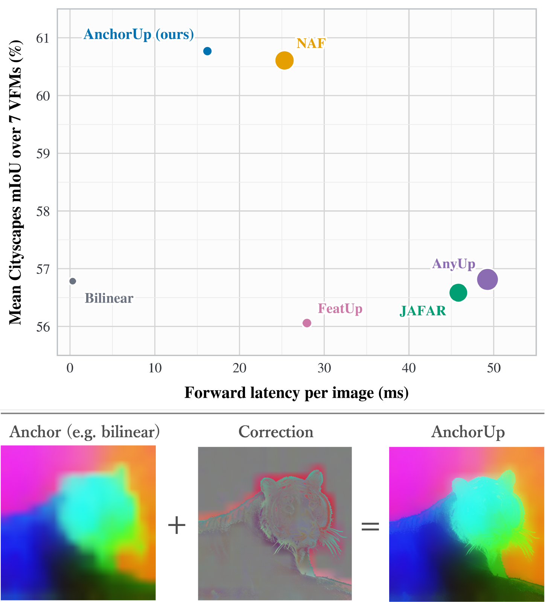
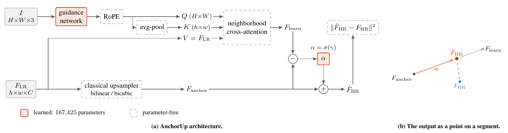
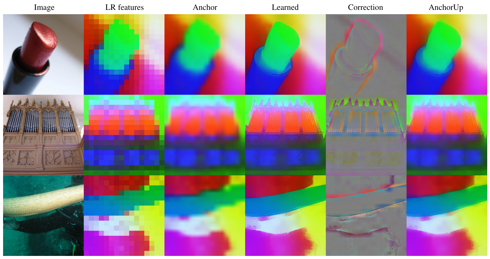

# ⚓ AnchorUp: Anchoring Feature Upsampling on a Classical Interpolation

> Kotaro Horikawa, Keisuke Toida, Junya Komori, Kazuhiro Hotta<br>
> Meijo University, Asia Air Survey Co., Ltd.<br>
> WACV 2027

AnchorUp upsamples vision foundation model features by learning a correction to a classical interpolation anchor. A compact RGB guidance network and a single scalar gate refine edges and fine details. Weights trained once on DINOv3-B/16 transfer to other backbones.

<p align="center">
  
</p>

**Accuracy against latency** on Cityscapes averaged over seven backbones; circle size shows the number of parameters. *Bottom:* the learned part supplies only a correction to a classical interpolation, so it focuses on missing details (outlines, whiskers, and fur) and stays flat over the background.

## 🧩 How it works

<p align="center">
  
</p>

**AnchorUp.** (a) A parameter-free classical upsampler gives the anchor, and a NAF-style upsampler, a guidance network followed by neighborhood cross-attention, gives the learned prediction. Only the guidance network and the gate $\alpha=\sigma(\gamma)$ have learnable parameters. (b) The output is a point on the segment between the two predictions: the network picks the direction, the gate picks the distance.

<a id="installation"></a>

## 🔧 Installation

Use Python 3.10 or newer:

```bash
git clone https://github.com/KotaroHorikawa/AnchorUp.git
cd AnchorUp
python3 -m venv .venv
source .venv/bin/activate
```

Install matching [PyTorch and torchvision](https://pytorch.org/get-started/locally/) and [NATTEN](https://natten.org/install/) builds for your CUDA version and GPU. Blackwell GPUs (SM120/SM121) require CUDA 12.8 or newer and NATTEN 0.21.7 or newer. Then install AnchorUp:

```bash
python -m pip install -r requirements.txt -e .
```

<a id="inference"></a>

## 🎯 Inference

Load AnchorUp through `torch.hub`. The weights are downloaded and cached on first use:

```python
import torch

model = torch.hub.load(
    "KotaroHorikawa/AnchorUp", "anchorup",
    anchor="bilinear", dim=128, device="cuda",
).eval()
# image: ImageNet-normalized RGB (B, 3, H, W)
# features: frozen VFM features (B, C, h, w)
with torch.inference_mode():
    output = model(image, features, image.shape[-2:])
```

`anchor`, `dim` and `steps` select an entry of the [weight tables](#pretrained-weights), for example `steps="300k"`. To load a downloaded file instead, pass `checkpoint_path="weights/anchorup-bilinear-d128-25k.pth"`. To extract and upsample features from an image:

```bash
python examples/inference.py --image image.jpg \
  --checkpoint weights/anchorup-bilinear-d128-25k.pth --output features.pt
```

The example loads DINOv3-B/16 through `timm` and saves a `(1, C, H, W)` feature tensor. Select another VFM with `--backbone <model-name>`.

## 🖼️ Feature visualizations

<p align="center">
  
</p>

**The correction is a boundary signal.** Feature maps are projected onto the first three principal components of each image and shown as RGB, with zero correction as mid-gray. The correction is flat inside regions and concentrates on contours and on the fine repeated structure the anchor cannot resolve.

<a id="pretrained-weights"></a>

## 📦 Pretrained weights

### Main models

| Model | Anchor | Guidance width | Steps | Download |
| --- | --- | --- | --- | --- |
| AnchorUp | bilinear | 128 | 25k | [anchorup-bilinear-d128-25k.pth](https://github.com/KotaroHorikawa/AnchorUp/releases/download/weights/anchorup-bilinear-d128-25k.pth) |
| AnchorUp | bicubic | 128 | 25k | [anchorup-bicubic-d128-25k.pth](https://github.com/KotaroHorikawa/AnchorUp/releases/download/weights/anchorup-bicubic-d128-25k.pth) |

### Guidance width ablation

Width 128 is the main model above.

| Model | Anchor | Guidance width | Steps | Download |
| --- | --- | --- | --- | --- |
| AnchorUp | bilinear | 32 | 25k | [anchorup-bilinear-d32-25k.pth](https://github.com/KotaroHorikawa/AnchorUp/releases/download/weights/anchorup-bilinear-d32-25k.pth) |
| AnchorUp | bilinear | 64 | 25k | [anchorup-bilinear-d64-25k.pth](https://github.com/KotaroHorikawa/AnchorUp/releases/download/weights/anchorup-bilinear-d64-25k.pth) |
| AnchorUp | bilinear | 256 | 25k | [anchorup-bilinear-d256-25k.pth](https://github.com/KotaroHorikawa/AnchorUp/releases/download/weights/anchorup-bilinear-d256-25k.pth) |
| AnchorUp | bicubic | 32 | 25k | [anchorup-bicubic-d32-25k.pth](https://github.com/KotaroHorikawa/AnchorUp/releases/download/weights/anchorup-bicubic-d32-25k.pth) |
| AnchorUp | bicubic | 64 | 25k | [anchorup-bicubic-d64-25k.pth](https://github.com/KotaroHorikawa/AnchorUp/releases/download/weights/anchorup-bicubic-d64-25k.pth) |
| AnchorUp | bicubic | 256 | 25k | [anchorup-bicubic-d256-25k.pth](https://github.com/KotaroHorikawa/AnchorUp/releases/download/weights/anchorup-bicubic-d256-25k.pth) |

### Training checkpoints

The bilinear main model is the 25k point.

| Model | Anchor | Guidance width | Steps | Download |
| --- | --- | --- | --- | --- |
| AnchorUp | bilinear | 128 | 12.5k | [anchorup-bilinear-d128-12p5k.pth](https://github.com/KotaroHorikawa/AnchorUp/releases/download/weights/anchorup-bilinear-d128-12p5k.pth) |
| AnchorUp | bilinear | 128 | 50k | [anchorup-bilinear-d128-50k.pth](https://github.com/KotaroHorikawa/AnchorUp/releases/download/weights/anchorup-bilinear-d128-50k.pth) |
| AnchorUp | bilinear | 128 | 100k | [anchorup-bilinear-d128-100k.pth](https://github.com/KotaroHorikawa/AnchorUp/releases/download/weights/anchorup-bilinear-d128-100k.pth) |
| AnchorUp | bilinear | 128 | 200k | [anchorup-bilinear-d128-200k.pth](https://github.com/KotaroHorikawa/AnchorUp/releases/download/weights/anchorup-bilinear-d128-200k.pth) |
| AnchorUp | bilinear | 128 | 300k | [anchorup-bilinear-d128-300k.pth](https://github.com/KotaroHorikawa/AnchorUp/releases/download/weights/anchorup-bilinear-d128-300k.pth) |

<details>
<summary>Comparison checkpoints</summary>

### NAF baselines

The stage 1 and stage 2 weights were trained with the NAF recipe at guidance width 128. The width-256 weights are the official NAF release from valeo.ai.

| Model | Anchor | Guidance width | Steps | Download |
| --- | --- | --- | --- | --- |
| NAF (stage 1) | — | 128 | 25k | [naf-d128-stage1-25k.pth](https://github.com/KotaroHorikawa/AnchorUp/releases/download/weights/naf-d128-stage1-25k.pth) |
| NAF (stage 2) | — | 128 | 2.5k (stage 2) | [naf-d128-stage2-2p5k.pth](https://github.com/KotaroHorikawa/AnchorUp/releases/download/weights/naf-d128-stage2-2p5k.pth) |
| NAF (official) | — | 256 | — | [naf_release.pth](https://github.com/valeoai/NAF/releases/download/model/naf_release.pth) |

</details>

<a id="datasets"></a>

## 🗂️ Datasets

Set `dataroot` to a directory with this layout:

```text
/path/to/datasets/
├── imagenet/images/
│   ├── train/
│   └── val/
├── VOCdevkit/VOC2012/
├── cityscapes/
│   ├── leftImg8bit/{train,val}/
│   └── gtFine/{train,val}/
└── DAVIS/
    ├── JPEGImages/480p/
    ├── Annotations/480p/
    └── ImageSets/2017/val.txt
```

The paper profile uses ImageNet train and val images. Segmentation probes use each dataset’s training split for fitting and its validation split for evaluation. Download commands are listed in [data.sh](docs/data.sh).

The ImageNet loader caches its image list at `imagenet/images.txt`. For a read-only `dataroot`, set `dataset.root_cache` to a writable directory, and use a new one when the image collection changes.

<a id="training"></a>

## 🚀 Training

Train either anchor with the paper profile:

```bash
python train.py +profile=paper_25k dataroot=/path/to/datasets \
  hydra.run.dir=output/train-bilinear
python train.py +profile=paper_25k model.base_mode=bicubic \
  dataroot=/path/to/datasets hydra.run.dir=output/train-bicubic
```

The run saves the 25k checkpoint as `output/train-bilinear/version_*/model_25000steps.pth`, together with the resolved settings and training log. Set `model.dim=32`, `64` or `256` for the guidance-width ablation. The training checkpoints from 12.5k to 300k steps come from `+profile=paper_300k`.

<a id="evaluation"></a>

## 📊 Evaluation

### Semantic segmentation

For a new linear probe, run:

```bash
python evaluation/eval_seg_probing.py dataset=voc \
  eval.model_ckpt=weights/anchorup-bilinear-d128-25k.pth \
  dataroot=/path/to/datasets hydra.run.dir=output/eval-voc
```

Use `dataset=cityscapes` for Cityscapes. The run saves `linear_probe.pth` and `seg_metrics.json`. Add `eval.probe_ckpt=output/eval-voc/linear_probe.pth` to re-evaluate a saved probe with the same dataset, VFM and upsampler.

Match the model options to the checkpoint: `model.base_mode=bicubic` for a bicubic anchor, `model.dim=<width>` for a width variant, and `model=naf model.dim=<width>` for NAF. FeatUp and JAFAR are trained per VFM, so pass the matching file with `model=featup` or `model=jafar`.

### Video object segmentation

```bash
python evaluation/eval_video_seg.py \
  eval.model_ckpt=weights/anchorup-bilinear-d128-25k.pth \
  dataset.root=/path/to/datasets/DAVIS hydra.run.dir=output/eval-davis
```

### Backbones

Evaluation uses DINOv3-B/16 by default. The paper evaluates the same upsampler on seven frozen VFMs, selected with `backbone.name=<name>`. DAVIS uses all of them except PEcore.

| VFM | `backbone.name` |
| --- | --- |
| DINOv3 | `vit_base_patch16_dinov3.lvd1689m` |
| CLIP (OpenCLIP, LAION-2B, fine-tuned on ImageNet-12k and ImageNet-1k) | `vit_base_patch16_clip_384.laion2b_ft_in12k_in1k` |
| SigLIP2 | `vit_base_patch16_siglip_512.v2_webli` |
| Franca | `franca_vitb14` |
| PEcore | `vit_pe_core_base_patch16_224.fb` |
| PEspatial | `vit_pe_spatial_base_patch16_512.fb` |
| RADIO | `radio_v2.5-b` |

### Latency

Table 4 measures the upsampler alone: batch 1, FP32, a 448x448 RGB image and 384x28x28 features upsampled to 448x448.

```bash
python analysis/benchmark_upsampler_latency.py \
  --methods bilinear bicubic anchorup anchorup_bicubic \
  --anchorup-checkpoint weights/anchorup-bilinear-d128-25k.pth \
  --anchorup-bicubic-checkpoint weights/anchorup-bicubic-d128-25k.pth
```

Omitting `--methods` runs all eight Table 4 methods. FeatUp then needs its compiled AdaptiveConv extension, installed with `pip install --no-deps --no-build-isolation git+https://github.com/mhamilton723/FeatUp.git` against your PyTorch and CUDA. The paper's measurements used an RTX PRO 6000 Blackwell Max-Q, PyTorch 2.6 and CUDA 12.8.

## 🔬 Analysis

`analysis/anchorup_diagnostics.py` reproduces the gate calibration (Table S1, Figure S1) and the spectra and PCA visualizations (Figures 3 and 4). List the images in a JSON array of paths, extract feature pairs, then run the analyses:

```bash
# Gate calibration on the 28x28 feature grid of 448 px images.
python -m analysis.anchorup_diagnostics extract --images images.json --image-size 448 --output pairs_448
python -m analysis.anchorup_diagnostics analyze --samples pairs_448/samples.json \
  --checkpoint weights/anchorup-bilinear-d128-25k.pth --analyses alpha --output alpha

# Spectra and PCA at the resolution of 512 px images.
python -m analysis.anchorup_diagnostics extract --images images.json --image-size 512 --output pairs_512
python -m analysis.anchorup_diagnostics analyze --samples pairs_512/samples.json \
  --checkpoint weights/anchorup-bilinear-d128-25k.pth --analyses spectrum pca \
  --output-size 512 512 --output figures
python -m analysis.plot_anchorup_spectrum --input figures/spectrum.npz --output figures/spectrum.pdf
```

Add `--alpha-mode fixed-bilinear-branch` for Figure S1.

## 📝 Citation

```bibtex
@inproceedings{horikawa2027anchorup,
  title     = {AnchorUp: Anchoring Feature Upsampling on a Classical Interpolation},
  author    = {Horikawa, Kotaro and Toida, Keisuke and Komori, Junya and Hotta, Kazuhiro},
  booktitle = {Proceedings of the IEEE/CVF Winter Conference on Applications of Computer Vision (WACV)},
  year      = {2027}
}
```

## 🙏 Acknowledgements

Built on [NAF](https://github.com/valeoai/NAF) ([paper](https://arxiv.org/abs/2511.18452)) and [NATTEN](https://github.com/SHI-Labs/NATTEN). Code derived from NAF has been modified. NAF and AnchorUp are released under the Apache License 2.0; see [LICENSE](LICENSE).
